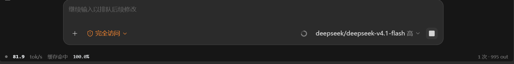

# ZCode Toolkit

A toolkit that upgrades the ZCode desktop app with three always-at-hand composer features, plus a request sanitizer that keeps Anthropic models happy. Everything is injected directly into the app — no MCP, no separate windows.



## Features

### 1. Inline token-rate bar
Live **tok/s** and **cache hit rate** rendered next to the composer toolbar, right-aligned before the model picker. Numbers come from ZCode's own model-io logs (`~/.zcode/cli/rollout/model-io-*.jsonl`), not UI scraping. Shrinks to rate + hit-rate only when the window gets narrow. Transparent background, monochrome palette, follows dark/light.

### 2. One-click region screenshot
A 📷 button next to the access-mode control (with a `∨` option: *hide ZCode while capturing*). Screen freezes during region selection; the crop is saved and auto-pasted into the composer. The capture engine is a tiny Win32 listener (`screenshot-plugin/`, global hotkey `Ctrl+Alt+A`).

### 3. One-click retry
A ↻ button beside the camera. When the composer is empty and the model is idle, one click fills `retry` via ZCode's own Lexical E2E bridge and clicks the official send button — a real resend, not clipboard tricks. Disabled while you're typing a draft or the model is generating. Duplicate sends are prevented by a cooldown.

### 4. Anthropic thinking-block sanitizer
ZCode replays reasoning blocks from other models (DeepSeek/GLM) to Anthropic, which rejects empty or unsigned `thinking` blocks with HTTP 400 (`non-whitespace thinking` / `Invalid signature`). The agent runtime gets an outbound `fetch` wrapper that strips those blocks before the request leaves.

## How it works

Two append-only patches, no repacking:

- `asar-patch/` — appends a main-process metrics server (`127.0.0.1:9335`) and a renderer script into `app.asar`. The 14 unpacked native modules are untouched.
- `agent-patch/` — appends the sanitizer to `resources/glm/zcode.cjs` (the process that actually talks to model providers).
- `plugin/` — a ZCode hook plugin (`zcode-toolkit`) that re-applies both patches on every session start, so ZCode updates don't wipe them.
- `tests/` — headless-browser and unit tests for the bar layout, retry flow, and sanitizer.

Patches are idempotent and content-hash based: after any snippet change the installer restores from its backup and re-applies automatically.

## Install

1. Fully quit ZCode (tray icon → Quit; closing the window just hides it).
2. Run:

   ```
   asar-patch\install-asar.bat
   node agent-patch/install-agent-fix.mjs
   ```

3. Start ZCode. On later ZCode updates, just restart once — the `zcode-toolkit` hook plugin re-applies everything.

Screenshot engine (one-time): see `screenshot-plugin/README.md`.

## Restore

```
node asar-patch/install-asar.mjs --restore
node agent-patch/install-agent-fix.mjs --restore
```

## Notes & safety

- Everything stays on `127.0.0.1`; the metrics server binds loopback only.
- The screenshot paste uses calibrated synthetic clicks; disable ZCode's "close to tray" if you hit focus-loss quirks.
- Patches touch app files — keep the `.tokbar-bak` / `.thinkingfix-bak` backups around.

---

# ZCode Toolkit（简体中文）

给 ZCode 桌面版补上三个输入框旁的常驻功能，外加一个让 Anthropic 模型不再 400 的请求净化器。全部注入进应用本体，没有 MCP、没有多余窗口。


## 功能

1. **内联速率条** — 输入框工具栏右侧实时显示 **tok/s** 和**缓存命中率**，数据来自 ZCode 自己的 model-io 日志；窗口变窄自动只留速率 + 命中率；透明底、黑白灰配色、跟随深浅色。
2. **一键区域截图** — 📷 按钮（`∨` 可选“截屏时隐藏当前界面”），框选期间画面冻结，截完自动粘贴进输入框；引擎是独立的 Win32 监听器（`screenshot-plugin/`，全局热键 `Ctrl+Alt+A`）。
3. **一键 retry** — ↻ 按钮：输入框为空且模型空闲时，点一下就走 ZCode 官方 Lexical 桥填入 `retry` 并点官方发送钮，等效真实重发；有草稿或生成中时自动禁用，冷却防重复。
4. **thinking 块净化器** — ZCode 会把 DeepSeek/GLM 产生的推理块原样回放给 Anthropic，空内容或无签名都会被 400 拒绝；agent 运行时的出站请求会自动剔除这些块。

## 原理

两个**追加式补丁**，不重打包：

| 目录 | 作用 |
|---|---|
| `asar-patch/` | 向 `app.asar` 追加主进程指标服务（`127.0.0.1:9335`）和渲染层脚本，14 个 unpacked 原生模块不受影响 |
| `agent-patch/` | 向 `resources/glm/zcode.cjs`（真正发模型请求的进程）追加出站净化 |
| `plugin/` | ZCode 插件 `zcode-toolkit`：每次会话启动自动重打两个补丁，ZCode 升级不掉 |
| `tests/` | 无头浏览器 + 单元测试（布局、retry 流程、净化器） |

补丁按内容 hash 判重：片段更新后安装器自动从备份还原再重打。

## 安装

1. **完全退出 ZCode**（托盘右键退出，关窗口只是最小化）。
2. 依次运行 `asar-patch\install-asar.bat` 和 `node agent-patch/install-agent-fix.mjs`。
3. 启动 ZCode。以后 ZCode 升级后重启一次即可，hook 插件会自动补回去。

## 还原

```
node asar-patch/install-asar.mjs --restore
node agent-patch/install-agent-fix.mjs --restore
```
